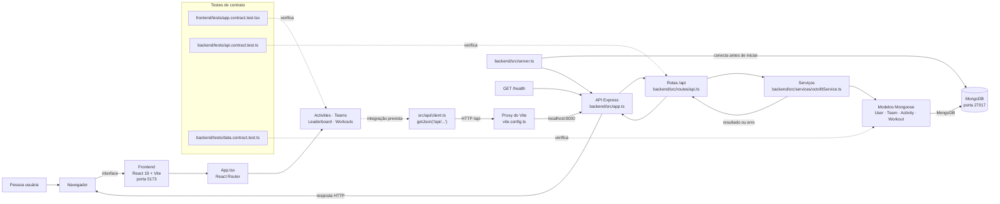
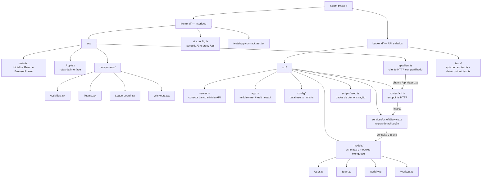

# Diagramas do OctoFit Tracker

Este documento detalha como as partes do OctoFit Tracker se conectam e onde cada responsabilidade está organizada no repositório.

## Diagrama de arquitetura

O navegador usa caminhos relativos `/api`; durante o desenvolvimento, o Vite encaminha essas chamadas da porta `5173` para o Express na porta `8000`. O backend usa Mongoose para acessar o MongoDB na porta `27017`. `VITE_API_BASE_URL` pode substituir a URL-base do cliente.

## Fluxograma da estrutura do projeto

> **Estado atual:** o projeto contém a estrutura e os contratos dos recursos, mas partes ainda são scaffolding. Os componentes de capacidade exibem “Implementation pending” e ainda não chamam o cliente de API. No backend, criação de atividades e equipes responde `501`, e o leaderboard ainda retorna uma lista vazia.
